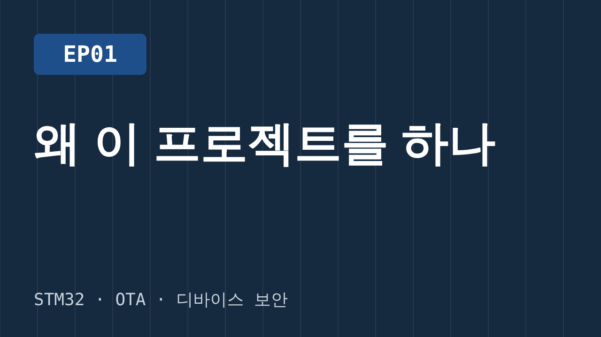
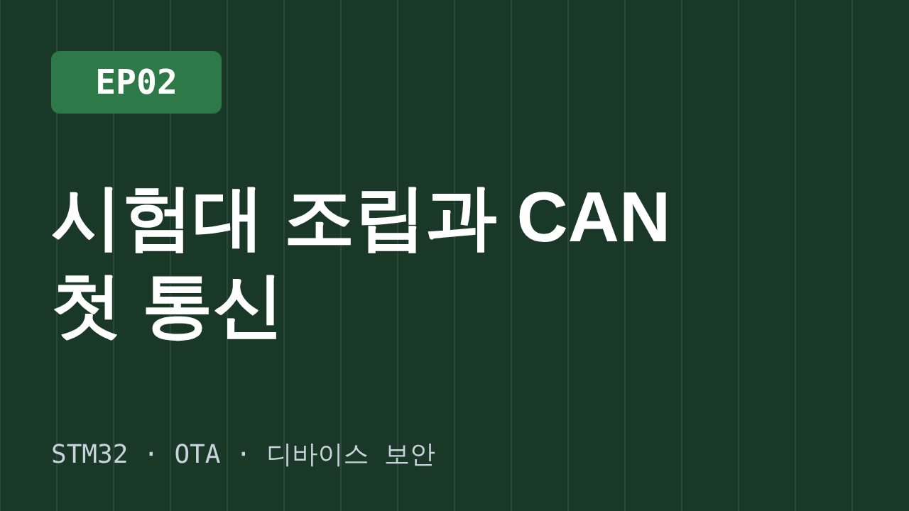
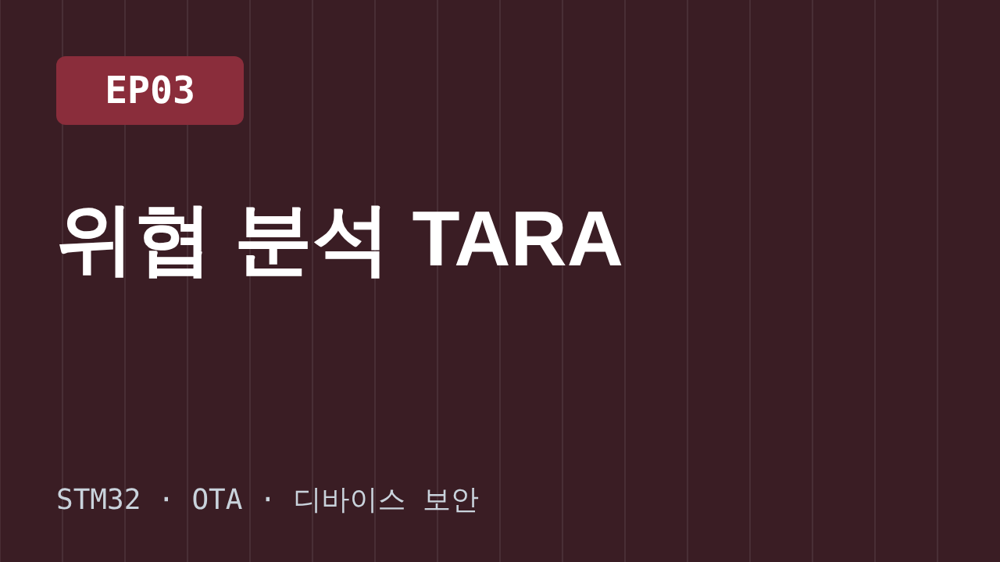
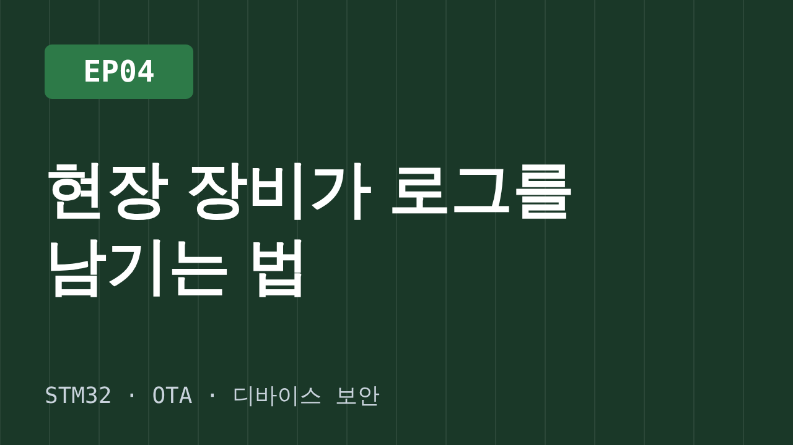
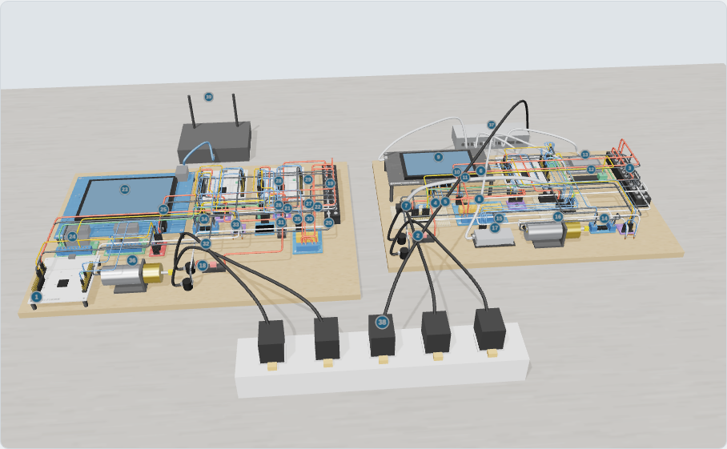
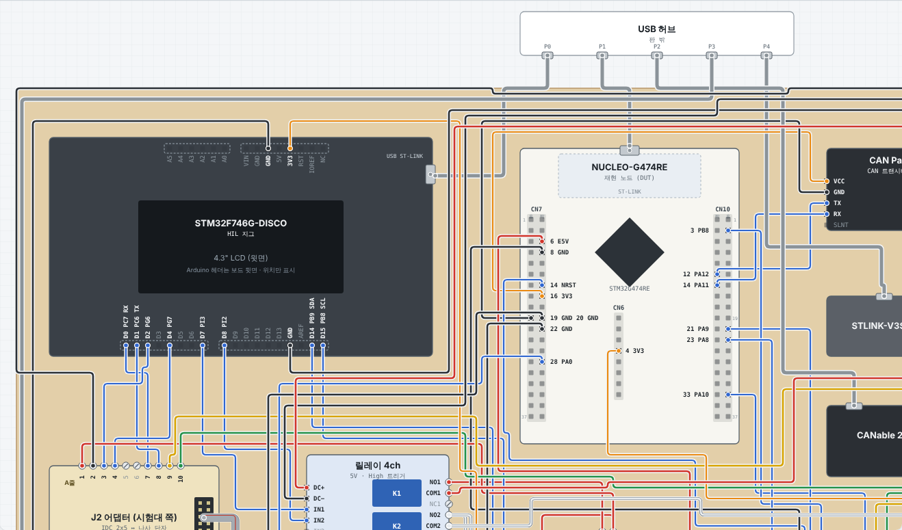

---
hide:
  - navigation
  - toc
---

# 현장 로그부터 서명 OTA까지, 영상 보며 같이 만들어요

STM32 보드 5개로 시험대를 만들고, 고장 재현 · 자동 시험 · 서명된 원격 업데이트를 단계별로 따라 해요. 회차마다 코드 시작점과 정답이 태그로 남아 있어요.

[:material-play: EP01부터 보기](episodes/ep01.md){ .md-button .md-button--primary }
[부품 목록](start/parts.md){ .md-button }
[:fontawesome-brands-github: 코드](https://github.com/SmileBeen/stm32-ota-bench){ .md-button }

현장 노드→게이트웨이→서버→연구소 재현·수정→서명 이미지→OTA 배포

## 회차

<a class="ep" href="episodes/ep01/">
<b>EP01 왜 이 프로젝트를 하나</b>기획 · V-모델 촬영 준비
</a>
<a class="ep" href="episodes/">
<b>EP02 시험대 조립과 CAN</b>시스템 설계 예정
</a>
<a class="ep" href="episodes/">
<b>EP03 위협 분석 TARA</b>보안 요구사항 예정
</a>
<a class="ep" href="episodes/">
<b>EP04 현장 로그</b>링버퍼 · CAN · 업로드 예정
</a>

[전체 회차 9개 보기 →](episodes/index.md)

## 처음이라면

1. [부품 목록](start/parts.md)과 [안전 수칙](start/safety.md) 확인
2. [개발 환경](start/dev-env.md) 설치
3. [EP01](episodes/ep01.md)부터 따라 하기

막히면 [질문 게시판](https://github.com/SmileBeen/stm32-ota-bench/discussions)에 회차와 단계를 적어 남겨 주세요.

## 최근 개발 일지

- [프로젝트를 시작해요](blog/posts/2026-10-29-start.md) · 10/29
- [촬영·작업 환경 정리](start/workspace.md) · 10/29

[일지 전체 →](blog/index.md)

## 시험대 미리보기

<a href="bench/assembly.html">3D 조립 가이드 · 부품 39개 고정 방법</a>
<a href="bench/assembly.html">2D 배선 모형도 · 선 152가닥</a>

---

:fontawesome-brands-youtube: [유튜브](https://www.youtube.com/) · :fontawesome-brands-github: [GitHub](https://github.com/SmileBeen/stm32-ota-bench) · 코드 MIT · 문서 CC BY 4.0
